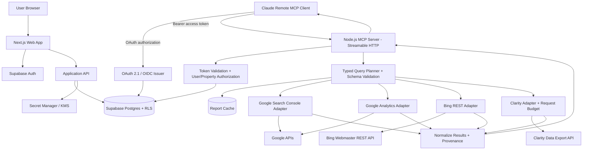

# Technical Requirements Document (TRD)

## SEO Analytics MCP Connector

**Document status:** Draft for implementation  
**Version:** 1.0  
**Last updated:** 19 October 2026  
**Companion document:** [`PRD.md`](./PRD.md)

---

## 1. Purpose and technical summary

This document defines the proposed technical architecture, auth model, database design, MCP tool contracts, provider adapters, security controls, runtime operations and test strategy for a public multi-tenant analytics MCP service.

The architecture deliberately separates:

1. The web application and SaaS user identity.
2. OAuth/API credentials for each provider identity.
3. The provider property registry and per-user property allowlist.
4. The MCP resource server and the identity represented by the MCP access token.
5. Provider API calls, validation, cache, quota management and response normalization.

**Key account rule:** one SaaS user may connect GSC via Google Account B, GA4 via Google Account C and sign in to the SaaS with Account A. OAuth grants must be associated with the internal SaaS `user_id`, not matched by email and not derived from a tool argument.

## 2. Proposed stack

| Layer | Recommended choice | Rationale / notes |
|---|---|---|
| Web app | Next.js + TypeScript | Signup, provider connection wizard, property selection, settings and setup docs |
| UI | Tailwind CSS + accessible component library | Fast delivery and consistent dashboard UX |
| Application identity | Supabase Auth | Sign in/up and first-party web sessions |
| Database | Supabase Postgres | Multi-tenant metadata, connection state, cache references, audit records |
| Database authorization | Postgres RLS plus explicit server-side ownership checks | RLS is defense-in-depth, not a substitute for checks in privileged code |
| Provider secret encryption | Managed KMS/secret manager with envelope encryption | Keep master key outside the database and frontend; do not store ciphertext key beside tokens |
| MCP server | Dedicated TypeScript Node.js service using the official MCP TypeScript SDK | Independent lifecycle, easier transport and monitoring management; avoid coupling core MCP operation to frontend serverless request limits |
| MCP transport | Streamable HTTP over HTTPS | Use the current MCP authorization spec and Claude-supported remote transport |
| MCP OAuth / issuer | Evaluate Supabase OAuth 2.1 Server first; fall back to a dedicated OAuth/OIDC issuer if required | Must prove discovery, DCR/client behavior, consent, resource/audience validation, refresh and revocation end to end |
| Google SDKs | Official Google APIs Node.js client libraries | OAuth/token lifecycle, Search Console, Analytics Admin and Analytics Data APIs |
| Microsoft integrations | Isolated TypeScript HTTP clients/adapters | Clarity API token; Bing current supported REST API and OAuth flow |
| Cache | Postgres-backed cache for MVP; managed Redis can be added when load warrants it | Avoid adding another datastore until metrics justify it |
| Monitoring | Structured logs, error tracking and metrics | Provider status, latency, quota, token refresh, cache hit rate, MCP success |
| Hosting | Web on a Next.js-friendly platform; MCP as a long-running Node service (for example Cloud Run, Render, Fly.io or equivalent) | Keep MCP scaling/runtime independently deployable; select region and secret service based on privacy/cost constraints |

These are recommended starting choices, not vendor requirements. Before implementation, test the exact OAuth server and MCP SDK versions against the current Claude connector behavior.

## 3. System architecture



### 3.1 Deployment boundaries

- **Web app:** public frontend, session-based application API routes and provider authorization initiation/callback handlers.
- **MCP service:** separate deployment, server-side OAuth/resource validation, tool schemas and provider query execution.
- **Database:** application metadata and cache, not a data warehouse in MVP.
- **Secret service:** encryption key material and server-side credentials. Provider secrets are stored encrypted in Postgres or a managed secret store, but decryption must occur only in trusted server runtime.
- **Provider adapter:** each upstream is isolated so that Bing API changes, token lifecycle changes or different limits do not require changing shared MCP contracts.

### 3.2 Why not make every API request from the browser?

Provider tokens and refresh tokens would be exposed to browser attack surfaces, MCP calls need server-side tenant checks, API secrets would leak, and usage limits could be bypassed. All provider calls must execute on trusted server infrastructure.

### 3.3 Why a dedicated MCP service?

A separate process lets the MCP endpoint scale and deploy independently, isolates provider query failures from dashboard navigation, and gives a single place to apply auth, timeouts, structured results and rate limits. Supabase Edge Functions can be considered for a prototype, but do not assume a serverless function is appropriate for every transport behavior or request duration; verify actual stream handling and runtime limits before production.

## 4. Identity and authorization model

### 4.1 Three independent identities

**A. SaaS identity**

- Issuer: Supabase Auth.
- Stable key: `auth.users.id` / UUID `user_id`.
- Email is display/communication data, not the authorization key.

**B. Provider connection identity**

- Google OAuth grant can belong to Account B for GSC and Account C for GA4.
- Each grant is tied to the SaaS `user_id` that initiated it.
- Persist Google `sub` or another verified stable provider-account identifier where supplied, plus granted scopes and connection status.
- Do not make connection ownership contingent on provider email matching the SaaS email.
- When one Google grant contains both `webmasters.readonly` and `analytics.readonly`, the grant may be used for accessible properties of both provider services. If different accounts are used, create separate provider grants.

**C. MCP identity**

- OAuth issuer: the SaaS's OAuth 2.1/OIDC service.
- MCP access token represents the SaaS user and appropriate authorization context.
- Access token audience/resource must match this MCP server according to the chosen spec/profile.
- Provider tokens never go to Claude.

### 4.2 Auth flows

#### SaaS login

Use Supabase Auth Google provider (or another allowed login option in future) only for identity. Do not infer data permissions from the login scope.

#### GSC connection

- Start OAuth authorization code flow using SaaS-owned Google Cloud OAuth client.
- Request `https://www.googleapis.com/auth/webmasters.readonly`.
- Request offline access if server-side API access must continue while user is absent.
- Use state, strict redirect URI validation, and secure one-time callback handling.
- Use `prompt=select_account` where useful for clear account selection, without assuming it guarantees the chosen account has site access.
- Exchange the code server-side, encrypt persisted tokens, record grants and query `GET https://www.googleapis.com/webmasters/v3/sites`.

#### GA4 connection

- Request `https://www.googleapis.com/auth/analytics.readonly`.
- Discover properties using Analytics Admin API methods supported by current SDK/reference, then validate access by calling a Data API metadata/report method.
- If the user already connected another Google account, preserve that distinct grant.
- Avoid forcing GSC and GA4 to share an account.

#### Combined Google grant handling

Recommended UX: separate “Connect GSC” and “Connect GA4” actions because they represent distinct user intents and scopes. If the same account authorizes both, incremental authorization can avoid unnecessary duplication, but the credential storage model must handle separate grants and scope sets correctly. Never silently expand scopes during an unrelated connection action.

#### Bing

- Use SaaS-owned application registration and current supported OAuth 2.0 delegated-access flow.
- Microsoft documents a transition from legacy SOAP/POX routes, scheduled for retirement on 31 August 2026. As of this document date, implement only REST endpoints confirmed in the current API reference and verify OAuth token audience/scope requirements with an actual account.
- Do not depend on old `/webmaster/api.svc` examples in production.

#### Clarity

- User obtains project token in Clarity project settings; project admins manage token creation.
- Token is sent to server over TLS and stored encrypted.
- Call `GET https://www.clarity.ms/export-data/api/v1/project-live-insights` with the supported query parameters and `Authorization: Bearer <token>`.
- Tokens are project-specific for practical management and budget tracking; associate each credential with the owning SaaS user and project record.

#### MCP client authentication

- Use the current MCP HTTP authorization specification supported by the target Claude remote connector.
- Implement OAuth authorization code flow with PKCE as required by the deployed MCP OAuth profile; support discovery and Dynamic Client Registration if required by the target client.
- MCP tokens must be short-lived enough for the issuer's policy and support refresh/revocation consistent with that implementation.
- Validate `iss`, `aud`/resource, expiry, client/session grants and required scopes on every MCP request.
- Derive `user_id` from the validated principal; reject identity passed by the tool caller.
- Bind tool access to the user's allowed connection profile and property list.

### 4.3 Supabase OAuth 2.1 Server decision gate

Supabase currently documents an OAuth 2.1/OIDC server with MCP as a target use case. Before adopting it as the production issuer, a spike must confirm all of the following:

- Claude can discover the authorization/resource metadata and complete login/consent.
- Required client registration behavior works (DCR or configured client credentials as supported).
- Resource/audience constraints are compatible with the MCP server.
- Token refresh and revocation operate correctly.
- User consent maps to the correct internal user and allowed MCP profile.
- RLS/authorization controls do not accidentally grant access beyond the user.

If any critical criterion fails, use a dedicated OAuth/OIDC provider rather than implementing an incomplete authorization spec.

## 5. Provider adapter contracts

Each adapter should expose a stable internal interface and map provider-specific errors to a shared error model.

Example TypeScript interface:

```ts
export interface ProviderAdapter {
  listProperties(connectionId: string): Promise<ProviderProperty[]>;
  validateConnection(connectionId: string): Promise<ConnectionValidationResult>;
  getCapabilities(propertyId: string): Promise<ProviderCapabilities>;
}

export interface ReportAdapter {
  queryReport(
    input: NormalizedReportQuery,
    context: AuthorizedQueryContext,
  ): Promise<NormalizedReportResult>;
}
```

The interface is illustrative. Do not pass raw user IDs or provider tokens from the model. The backend constructs `AuthorizedQueryContext` only after token validation, connection lookup and property ownership checks.

### 5.1 Google Search Console adapter

- APIs: Search Console `sites.list`, `searchAnalytics.query`.
- Scope: `webmasters.readonly`.
- Native property key: URL-prefix or domain property string, including `sc-domain:` prefix.
- Fields: clicks, impressions, CTR, average position; dimensions such as page, query, date, country, device, search appearance, subject to endpoint semantics.
- Query date behavior: Search Analytics API specifies dates in Pacific Time.
- Retention: performance data is generally available within a rolling 16-month window unless exported separately.
- Row behavior: max `rowLimit` of 25,000 per request with `startRow` offset available, but Google notes internal limits mean all data rows are not guaranteed. Pagination is not a promise of completeness.
- Freshness: recent dates can be incomplete. The date resolver should use the requested window where appropriate but communicate when the final day may not be complete. Default policy can target a safer latest-complete date and optionally allow explicitly requested fresh/partial data.
- Adapter must guard against unsupported aggregation combinations and incompatible page filtering/grouping behavior.
- Rate limits/quotas must be read from the latest Google documentation and handled without hard-coding assumptions beyond configurable guardrails.

### 5.2 GA4 adapter

- APIs: Analytics Admin API for property/account discovery; Analytics Data API `runReport`, `getMetadata`, `checkCompatibility` and quota metadata as supported by current API version.
- Scope: `analytics.readonly`.
- Native property key: numeric GA4 property ID; not a Universal Analytics view ID.
- Query shape: dimensions, metrics, date ranges, dimension filters, metric filters where supported, orderBys, limit, offset/page token where supported.
- Compatibility: call `getMetadata` and/or `checkCompatibility`; do not assume all valid individual dimensions and metrics can be used together.
- Timezone: use property reporting time zone where available and clearly mark reporting dates.
- Quota: capture `returnPropertyQuota` where supported and enforce concurrency, token-use and error budgets. The official documentation lists standard property quotas, but values can change, so treat them as observed operational constraints, not permanent constants.
- Preserve response metadata, rowCount, pagination token, thresholding/truncation warnings and metric value types.

### 5.3 Bing Webmaster adapter

- Only implement current REST endpoints from current Microsoft reference.
- Required pre-production evidence: working OAuth 2.0 token, site list, a useful read-only report endpoint, current request/response schema and tests against live data.
- Use feature flag `PROVIDER_BING_ENABLED=false` until these checks pass.
- Map unsupported endpoints to a clean `PROVIDER_CAPABILITY_UNAVAILABLE` error.
- No write endpoints in MVP even if the provider API supports URL submission or sitemap operations.

### 5.4 Clarity adapter

- Endpoint: `GET https://www.clarity.ms/export-data/api/v1/project-live-insights`.
- Auth: project API token in bearer header.
- `numOfDays`: `1`, `2`, or `3`.
- Maximum 10 API requests per project per day; maximum three dimensions; maximum 1,000 rows; no pagination.
- Supported dimensions/metrics may evolve; validate the current provider documentation and schema instead of hard-coding undocumented fields.
- Current docs state results are returned in UTC.
- Budget is tracked by Clarity project token/project, not just by SaaS user, so two separate user records for the same external project should not accidentally multiply calls if the product can identify the same project safely.
- Default to cache-first. A cache miss should trigger an upstream request only if budget remains and the query is supported. If not, return cached data with its timestamp or a clear budget/window error.

## 6. Query planner and normalized response

### 6.1 Pipeline

1. Validate MCP token and resource audience.
2. Resolve internal user and allowed connection profile.
3. Parse tool arguments using JSON Schema/Zod.
4. Resolve property from the user's own selected-property records; ignore/forbid unregistered values.
5. Resolve relative date expression into explicit start/end dates in deterministic code, not model-only interpretation.
6. Validate date range and provider limits.
7. Validate dimensions/metrics/filters/operators against provider adapter capabilities and live metadata where practical.
8. Canonicalize query for cache key generation.
9. Acquire per-user, per-property, per-provider concurrency/request budget.
10. Return valid cached result if fresh enough, else call provider with timeout.
11. Normalize data, warnings, pagination and metadata.
12. Cache successful responses according to freshness policy.
13. Return compact structured MCP output and useful textual summary.

### 6.2 Relative date rules

- “Last N days” must resolve to explicit dates and specify whether the current day is included.
- Default behavior: completed days only, excluding today and any provider-specific partial latest date, unless the user explicitly asks for current/partial data.
- GSC reporting dates follow the Search Analytics API's Pacific Time contract; do not silently resolve them using the user's browser timezone.
- GA4 uses property reporting timezone where applicable.
- Clarity's export window uses provider-defined relative `numOfDays` and UTC output; do not advertise exact 30-day behavior.
- Every tool result must include exact effective start/end dates or the equivalent provider-specific period.

### 6.3 Recommended normalized output

```json
{
  "provider": "google_search_console",
  "property": {
    "id": "sc-domain:example.com",
    "name": "example.com"
  },
  "report": {
    "startDate": "2026-09-20",
    "endDate": "2026-10-09",
    "dateSemantics": "Google Search Console reporting date (Pacific Time)",
    "dimensions": ["page"],
    "metrics": ["clicks", "impressions", "ctr", "position"],
    "sort": [{"field": "clicks", "direction": "desc"}],
    "limit": 20
  },
  "rows": [],
  "rowCountReturned": 0,
  "rowCountReportedByProvider": null,
  "fetchedAt": "2026-10-19T05:00:00Z",
  "cache": {"hit": false, "ageSeconds": 0},
  "completeness": "unknown_or_provider_limited",
  "warnings": [],
  "requestId": "opaque-correlation-id"
}
```

This is an illustrative response contract. In a real query, populate the rows and set completeness metadata according to what the provider actually guarantees. Do not return a fake timestamp or invented count in production code.

### 6.4 Error contract

```ts
export type ConnectorErrorCode =
  | "AUTH_REQUIRED"
  | "AUTH_EXPIRED"
  | "AUTH_REVOKED"
  | "FORBIDDEN"
  | "PROPERTY_NOT_CONNECTED"
  | "PROPERTY_NOT_ACCESSIBLE"
  | "INVALID_QUERY"
  | "DIMENSION_METRIC_INCOMPATIBLE"
  | "DATE_RANGE_UNSUPPORTED"
  | "PROVIDER_RATE_LIMITED"
  | "PROVIDER_UNAVAILABLE"
  | "PROVIDER_CAPABILITY_UNAVAILABLE"
  | "CLARITY_DAILY_BUDGET_EXHAUSTED"
  | "PARTIAL_DATA"
  | "INTERNAL_ERROR";

export interface ConnectorError {
  code: ConnectorErrorCode;
  message: string;
  retryable: boolean;
  provider?: string;
  requestId: string;
  suggestedAction?: string;
  retryAfterSeconds?: number;
}
```

Only expose retry timing if the provider or rate-limit controller supplies a reliable value. Don't return raw stack traces or unredacted upstream responses to Claude.

## 7. MCP tool definitions

All tools must be read-only. Tool arguments are untrusted input. Property ownership, provider credentials, account identity, API endpoint URLs and authorization headers are server-managed.

### 7.1 `get_connection_status`

Inputs: none (or optional allowed profile identifier if profile access is server-verified).  
Returns: authorized user's provider connections, property counts, state, last validation time and reconnection status. Never return tokens or raw secret values.

### 7.2 `list_gsc_properties`

Inputs: optional connection ID only if it belongs to caller; optional refresh flag subject to rate control.  
Returns: enabled/available properties, permission level when returned by provider, connection alias and last synced status.

### 7.3 `query_gsc_performance`

Suggested inputs:

```ts
const QueryGscSchema = z.object({
  propertyId: z.string().min(1).max(2048),
  startDate: z.string().regex(/^\d{4}-\d{2}-\d{2}$/),
  endDate: z.string().regex(/^\d{4}-\d{2}-\d{2}$/),
  dimensions: z.array(z.enum([
    "date", "page", "query", "country", "device", "searchAppearance"
  ])).max(6).default(["page"]),
  type: z.enum(["web", "image", "video", "news", "discover", "googleNews"]).default("web"),
  filters: z.array(GscFilterSchema).max(10).default([]),
  sortBy: z.enum(["clicks", "impressions", "ctr", "position"]).default("clicks"),
  sortDirection: z.enum(["asc", "desc"]).default("desc"),
  limit: z.number().int().min(1).max(1000).default(25),
}).strict();
```

This is a suggested product schema. Backend should map to valid Google API fields and choose an appropriately capped internal limit. It may retrieve in pages within quota when useful but must not claim complete data if Google's internal limits prevent it.

### 7.4 `list_ga4_properties`

Inputs: optional connection ID and refresh flag, validated for the current user.  
Returns: accessible GA4 property IDs/names, account label if available, reporting timezone when discoverable, last validation time.

### 7.5 `query_ga4_report`

Suggested inputs:

- property ID
- explicit start/end dates or a supported period enum that backend resolves
- dimension names
- metric names
- dimension filters / metric filters using typed operators
- sort/order specification
- limit and page offset/token where supported

Implementation notes:

- Use `getMetadata` and `checkCompatibility` before report execution or cache the metadata by property and API version.
- Limit the number of dimensions, metrics and filters.
- Return row count and pagination token where present.
- Include sampling, thresholding or truncation metadata as supplied by the API.
- Default to a bounded row limit (for example 100) and allow a hard maximum (for example 1,000) pending UX and API testing.

### 7.6 `get_clarity_insights`

Inputs: allowed Clarity connection/project ID, `numOfDays` enum `1 | 2 | 3`, up to three documented dimensions.  
Backend behavior: enforce project token ownership, daily budget and cache policy before calling Clarity. No arbitrary API URL or raw auth header can be specified by caller.

### 7.7 `list_bing_sites` and `query_bing_performance`

Do not enable these tools until `PROVIDER_BING_ENABLED` is true and required live integration tests pass. Use only explicit supported request/response schemas for current REST endpoints. No generic Bing API proxy.

### 7.8 `get_supported_metrics`

Inputs: provider and optionally selected property.  
Returns: currently supported dimensions/metrics, compatibility caveats, date limits, output limits and provider warnings. GA4 metadata should be property-specific when custom dimensions/metrics matter. Capabilities should be generated from tested adapters, not solely from free-form model knowledge.

## 8. Data model

Use migrations in version control. All user-owned tables require RLS unless the table is server-only and access is blocked to clients. In all cases, privileged server endpoints must perform explicit ownership checks.

### 8.1 Tables

#### `profiles`

| Column | Type | Notes |
|---|---|---|
| `user_id` | UUID PK / FK to `auth.users.id` | Stable SaaS owner |
| `display_name` | TEXT nullable | UX only |
| `created_at` | TIMESTAMPTZ | |
| `updated_at` | TIMESTAMPTZ | |

#### `provider_connections`

| Column | Type | Notes |
|---|---|---|
| `id` | UUID PK | Internal connection ID |
| `user_id` | UUID FK | Owner SaaS user |
| `provider` | ENUM/TEXT | `google`, `bing`, `clarity` |
| `provider_account_id` | TEXT nullable | Stable external subject/identifier where available; do not use email as only identity key |
| `account_label` | TEXT nullable | Masked or displayed email/name for UX |
| `status` | ENUM/TEXT | `connected`, `needs_attention`, `revoked`, `disconnected`, `pending` |
| `granted_scopes` | TEXT[] / JSONB | Granted scope set; avoid secret values |
| `secret_ref` | TEXT nullable | Reference into secret manager or identifier for encrypted secret record |
| `credential_version` | INT | Supports rotation/migration |
| `last_validated_at` | TIMESTAMPTZ nullable | |
| `last_error_code` | TEXT nullable | Safe normalized error only |
| `created_at` / `updated_at` | TIMESTAMPTZ | |

#### `provider_secrets` (server-only, if storing ciphertext in Postgres)

| Column | Type | Notes |
|---|---|---|
| `id` | UUID PK | |
| `connection_id` | UUID FK unique or one-to-many when credential versions required | |
| `ciphertext` | BYTEA/TEXT | Authenticated-encrypted payload, never plaintext |
| `key_version` | TEXT | Version of KMS/envelope key |
| `nonce` | BYTEA | Required by the chosen AEAD mode |
| `auth_tag` | BYTEA nullable | Depends on crypto library/mode |
| `created_at` | TIMESTAMPTZ | |
| `rotated_at` | TIMESTAMPTZ nullable | |

Use an established cryptographic library and managed KMS/envelope encryption. Do not invent cryptographic primitives. Prefer storing only a secret-manager reference if the operational model makes that practical.

#### `properties`

| Column | Type | Notes |
|---|---|---|
| `id` | UUID PK | Internal ID |
| `user_id` | UUID FK | Duplicated owner for straightforward ownership checks and RLS |
| `connection_id` | UUID FK | Exact provider grant/token used for this property |
| `provider` | TEXT | Denormalized for indexes and validation |
| `external_property_id` | TEXT | Provider-native immutable key |
| `display_name` | TEXT | |
| `property_type` | TEXT nullable | GSC domain/url prefix, GA4 property, Bing site, Clarity project |
| `timezone` | TEXT nullable | Provider property timezone where applicable |
| `enabled_for_mcp` | BOOLEAN default true | User allowlist control |
| `last_discovered_at` | TIMESTAMPTZ nullable | |
| `created_at` / `updated_at` | TIMESTAMPTZ | |

Recommended uniqueness: `(connection_id, provider, external_property_id)`.

#### `mcp_connection_profiles`

| Column | Type | Notes |
|---|---|---|
| `id` | UUID PK | Internal profile ID |
| `user_id` | UUID FK | Owner SaaS user |
| `name` | TEXT | Human-readable profile name |
| `status` | TEXT | Active/revoked |
| `allowed_provider_connections` | UUID[] or normalized join table | Prefer join table if multiple policy attributes needed |
| `created_at` / `updated_at` | TIMESTAMPTZ | |

Do not use the profile UUID as a bearer secret. Access requires MCP OAuth authorization.

#### `mcp_profile_properties` (recommended normalized join)

- `profile_id` UUID FK
- `property_id` UUID FK
- primary key `(profile_id, property_id)`
- ownership and same-user constraints enforced in server logic/database where possible.

#### `report_cache`

| Column | Type | Notes |
|---|---|---|
| `id` | UUID PK | |
| `user_id` | UUID FK | Cache isolation |
| `provider` | TEXT | |
| `connection_id` | UUID FK | |
| `property_id` | UUID FK | |
| `canonical_query_hash` | TEXT | Hash of normalized query, excluding credentials |
| `query_metadata` | JSONB | Redacted, normalized query parameters |
| `result_payload` | JSONB | Report rows + provenance, with retention and size limits |
| `fetched_at` | TIMESTAMPTZ | |
| `expires_at` | TIMESTAMPTZ | |
| `row_count` | INT nullable | |
| `warnings` | JSONB | |

Recommended uniqueness: `(user_id, provider, connection_id, property_id, canonical_query_hash)`. Use TTL cleanup job. Consider separate large-object storage only if measured response sizes justify it.

#### `provider_request_budgets`

- `provider`, `connection_id` or `external_project_key`, `period_start`, `request_count`, `updated_at`
- Used to enforce Clarity's 10-request/project/day budget and future provider limits.
- Atomic increment/check must avoid concurrent requests exceeding the limit. Use a database transaction or Redis script, not a read-then-write race.

#### `audit_events`

- `id`, `user_id`, `event_type`, `provider`, `connection_id`, safe metadata JSONB, `request_id`, `created_at`
- Never log raw tokens, client secrets, raw authorization codes, or entire report responses by default.

#### `sync_jobs` (optional for MVP)

- `id`, `user_id`, `provider`, `connection_id`, `property_id`, `job_type`, `status`, `attempt_count`, `next_attempt_at`, `started_at`, `finished_at`, `safe_error_code`
- Add when background refresh or periodic collection is introduced.

### 8.2 Indexes

- `provider_connections(user_id, provider, status)`
- `properties(user_id, provider, enabled_for_mcp)`
- `properties(connection_id, external_property_id)` unique
- `report_cache(user_id, provider, property_id, canonical_query_hash)` unique
- `report_cache(expires_at)` for cleanup
- `provider_request_budgets(connection_id, period_start)` unique as appropriate
- `audit_events(user_id, created_at DESC)`

### 8.3 RLS policy intent

- Profiles: user may read/update their own row.
- Provider connections: user may read/manage only rows where `user_id = auth.uid()`.
- Properties: user may see/change only rows where `user_id = auth.uid()`.
- MCP profiles and join tables: user may manage their own profiles; joining a property from another user must fail.
- Provider secrets: no direct browser CRUD. Disable end-user access and use server-only operations.
- Report cache: client access should generally be disabled; MCP server queries through trusted server path and still checks owner. If browser cache visibility is later needed, add narrow RLS policies.
- Audit events: user may see only a minimal account activity view; sensitive internal diagnostics remain server-only.

The server must still perform explicit ownership checks, because any privileged Supabase/service-role client can bypass RLS.

## 9. Credential storage and lifecycle

### 9.1 Tokens and keys

- Google access tokens are short-lived; refresh tokens must be protected as high-value secrets.
- Bing credentials must be stored according to the actual current OAuth response lifecycle.
- Clarity API tokens are bearer credentials and must be treated as secrets.
- The MCP access token is a separate token issued by your OAuth issuer; never reuse a provider token.

### 9.2 Encryption

Recommended production approach: envelope encryption with a managed KMS. A data-encryption key encrypts each secret record using an authenticated encryption algorithm; a key-encryption key protects the data-encryption key. Store key version metadata, not master key material.

For a small prototype, use a managed secret store or an application encryption service whose master key is injected as a runtime secret, but create a rotation plan before public beta. Never commit secrets to source control, logs or `.env` files that enter Git. Commit only `.env.example` with placeholder names.

### 9.3 Refresh and reconnect

- Refresh Google tokens before/after expiry as supported by the official client library.
- Serialize refresh operations per credential to avoid refresh races.
- On `invalid_grant` or revoked credentials, mark connection as `needs_attention` and notify the user.
- Do not infinitely retry failed refresh tokens.
- Maintain a redacted audit record for connection/revocation/rotation.

### 9.4 Secret deletion

When disconnecting a provider, revoke the grant where supported, delete or destroy encrypted credential material, delete or expire related cache records, and mark the connection disconnected. If a Google grant provides multiple services, avoid revoking the entire grant when only one property is removed and other selected properties still depend on it.

## 10. Cache, quota and concurrency strategy

### 10.1 Cache key

Canonical cache key should include:

- internal user ID or scope-safe partition
- provider and connection ID
- internal property ID / external property ID
- normalized start/end date or Clarity period
- dimensions, metrics, filter groups/operators/values
- order by/sort direction
- limit/offset/page token
- API version and schema version where useful

Do not include secrets or access tokens in cache keys. Avoid normalizing away meaningful page paths or filter distinctions.

### 10.2 Starting TTLs (tune through usage data)

| Source/query | Initial TTL | Notes |
|---|---:|---|
| GSC recent/likely-changing dates | 15–30 minutes | Most recent data can update |
| GSC older completed dates | 4–24 hours | Longer TTL if retention/consistency supports it |
| GA4 recent dates | 5–15 minutes | Tune based on report freshness and quota |
| GA4 historical completed periods | 1–6 hours or longer | Avoid repeated identical requests |
| Clarity | Cache per exact supported period/dimensions until refresh policy permits | Never allow chat turns to exceed daily budget |
| Property lists | 5–30 minutes | Refresh after new OAuth connection or explicit refresh |

These are application defaults, not provider guarantees. Keep TTLs configurable by provider/query class.

### 10.3 Request throttling

- Per user: cap concurrent MCP tool calls and provider calls.
- Per property/connection: semaphore around refresh/report requests.
- Per provider: global concurrency and QPS limits.
- Clarity: atomic daily budget with margin for manual/health-check calls. A validation request consumes a real provider call, so track it in the same budget.
- If limit reached: return cache hit if allowed by requested freshness; else return actionable rate limit error.

### 10.4 Retry policy

- Retry only transient network failures, 429s, and selected 5xx errors.
- Respect `Retry-After` when reliable.
- Exponential backoff with jitter and a maximum attempt/deadline budget.
- Do not retry validation errors, 400s, 401s until token refresh has been attempted, or authorization failures indefinitely.
- Avoid multiplying retries across SDK, adapter and MCP layers.

## 11. Reliability objectives and operations

### 11.1 Service behavior

- Every incoming MCP request has a correlation/request ID.
- Every upstream call uses a timeout and cancellation signal.
- The MCP server can return a controlled error without terminating the process.
- One provider's outage must not disable status or query tools for other providers.
- A slow report must not block token refresh, property listing or unrelated users.

### 11.2 Suggested initial SLOs

- 99% of server-side requests complete without unhandled exception over a rolling 30-day pilot window, excluding upstream failures and caller auth errors.
- 95th percentile cache-hit tool latency under 1 second for typical reports.
- 95th percentile provider-backed report latency under 8 seconds for ordinary reports; revise after observing real APIs.
- Zero known cross-tenant disclosure defects.
- 100% of Clarity upstream calls accounted for in the daily budget controller.

These are initial internal targets and should be validated rather than advertised as guarantees.

### 11.3 Monitoring

Track at least:

- MCP request count, success/error rate, latency p50/p95/p99.
- OAuth success/failure, invalid state, token refresh, reconnect events.
- Provider API response code and latency by provider/endpoint class.
- Cache hits/misses/age/stale-served counts.
- GSC report row counts and partial-data warnings.
- GA4 quota use and compatibility errors.
- Clarity request budget, 401/403/429 and data freshness.
- Bing feature-flag state, auth state and endpoint errors.
- Supabase database/storage usage, slow queries and function errors.

Never use raw OAuth tokens, API keys or full unredacted provider request headers as metric labels.

## 12. Security threat model

### Assets

- Provider refresh tokens/access tokens/API tokens.
- Customer property IDs, performance reports and analytics data.
- SaaS sessions, MCP access tokens and OAuth client secret.
- Encryption keys and database service-role credentials.

### Main threats and controls

| Threat | Mitigation |
|---|---|
| Cross-tenant property ID injection | Resolve property from current user's DB records and profile allowlist before any provider call |
| Provider token leakage to Claude/browser/logs | Server-only storage, encrypted at rest, redacted logs, typed response allowlist |
| OAuth CSRF / account-linking mix-up | Random state, PKCE where appropriate, callback state validation, issuer/subject checks, strict redirect URI |
| Confused-deputy attacks through MCP | Validate token issuer/audience, authorize every tool, bind allowed profile/properties, no caller-supplied user ID trust |
| SQL injection / arbitrary query execution | Parameterized DB queries, no arbitrary SQL tool, strict typed schemas |
| SSRF through caller-supplied URL | No arbitrary external URL input; hard-coded provider hosts / allowlisted endpoints |
| Malicious text inside queries/page titles | Treat source data as untrusted; never execute returned text as instructions or use it for authorization |
| Token refresh race | Per-connection lock/serialization and idempotent persistence |
| Excess API cost / abuse | Rate limits, request budgets, bounded dimensions/rows/periods, cache and user-level quotas |
| Clarity token abuse | Project token encryption, ownership, budget tracking, user-visible revocation guidance |
| Secret key compromise | KMS/envelope encryption, access policy, rotation, audit and emergency revoke process |
| RLS bypass in privileged code | Explicit ownership queries, minimal service-role exposure, isolation tests and code review |
| Sensitive logging | Allowlisted safe fields, PII minimization, no tokens or raw auth codes |

### Prompt injection and tool safety

Provider fields may contain user-generated strings (search terms, URLs, titles, campaign names). MCP tools should return them as data. They must not be interpreted as authorization instructions, query-planner instructions, URLs to fetch, or code to execute. Tool descriptions should explicitly limit behavior to read-only analytics.

## 13. API constraints and implementation notes

### 13.1 GSC

- Read-only scope: `https://www.googleapis.com/auth/webmasters.readonly`.
- Discover accessible sites via `GET https://www.googleapis.com/webmasters/v3/sites`.
- Query via `POST https://www.googleapis.com/webmasters/v3/sites/{siteUrl}/searchAnalytics/query`.
- Native siteUrl supports URL-prefix properties and `sc-domain:domain.tld` domain properties.
- Search Analytics query has a `rowLimit` range up to 25,000 and `startRow` offset, but Google's docs say API results are limited by internal constraints and may not include all rows.
- Dates use Pacific Time per current Search Analytics API reference.
- Search Console Performance history is limited to a rolling 16-month window unless the owner has separately exported it.

### 13.2 GA4

- Read-only scope: `https://www.googleapis.com/auth/analytics.readonly`.
- Use GA4 Data API `runReport` and metadata/compatibility methods.
- For example: `POST https://analyticsdata.googleapis.com/v1beta/properties/{propertyId}:runReport`.
- Use metadata to avoid invalid dimensions/metrics. Include property quota metadata (`returnPropertyQuota`) when supported and relevant.
- The Data API is for GA4 properties, not legacy Universal Analytics views.
- Data API quotas are token-based and apply per property and project; current documented figures should be reviewed at build and before launch because API quota policies can change.

### 13.3 Bing Webmaster

- Microsoft currently documents OAuth 2.0 delegated access and REST APIs.
- Legacy SOAP/POX retirement date was 31 August 2026. The product date is after that deadline; no production dependency should be built on legacy protocols.
- Gate the adapter until current REST endpoint names, scopes/audience, pagination and supported read reports pass manual confirmation and automated live tests.

### 13.4 Clarity

- Data Export API: `GET https://www.clarity.ms/export-data/api/v1/project-live-insights`.
- Auth header: `Authorization: Bearer <project token>`.
- `numOfDays` accepts 1, 2 or 3.
- Hard limits: 10 API requests per project per day; at most three dimensions; at most 1,000 rows; no pagination.
- API returns data in UTC according to current docs.
- Cache aggressively and account for all validation calls. Do not expose unsupported 30-day Clarity questions as supported capabilities.

## 14. Suggested repository layout

```text
seo-analytics-mcp/
├─ apps/
│  ├─ web/                     # Next.js dashboard and application API routes
│  └─ mcp-server/               # Node.js Streamable HTTP MCP service
├─ packages/
│  ├─ contracts/               # Zod schemas, provider-neutral types, error contract
│  ├─ db/                      # SQL migrations and server DB utilities
│  ├─ auth/                    # user principal, OAuth helpers, authorization policies
│  ├─ secrets/                 # KMS/encryption service and token persistence
│  ├─ query-planner/            # date resolution, validation, canonical query and cache key
│  ├─ provider-gsc/              # GSC adapter
│  ├─ provider-ga4/              # Analytics Admin/Data API adapter
│  ├─ provider-bing/            # Bing REST adapter behind feature flag
│  ├─ provider-clarity/          # Clarity adapter and daily budget
│  ├─ cache/                    # report cache and TTL policy
│  └─ observability/             # redacted logs and metrics
├─ supabase/
│  ├─ migrations/
│  └─ config.toml
├─ tests/
│  ├─ unit/
│  ├─ integration/
│  ├─ tenant-isolation/
│  ├─ oauth-e2e/
│  └─ golden-queries/
├─ docs/
│  ├─ PRD.md
│  ├─ TRD.md
│  └─ runbooks/
├─ .env.example
├─ package.json
└─ README.md
```

The final file structure can change. Keep provider adapters isolated and shared contracts versioned.

## 15. Environment configuration

Use environment variable names only in `.env.example`; never commit real values.

```dotenv
# Public app
NEXT_PUBLIC_APP_URL=https://app.example.com
NEXT_PUBLIC_SUPABASE_URL=https://your-project.supabase.co
NEXT_PUBLIC_SUPABASE_ANON_KEY=replace-with-public-anon-key

# Server-only Supabase
SUPABASE_SERVICE_ROLE_KEY=server-only
SUPABASE_DB_URL=server-only

# Google OAuth - the SaaS operator's OAuth client
GOOGLE_CLIENT_ID=server-only
GOOGLE_CLIENT_SECRET=server-only
GOOGLE_REDIRECT_URI=https://app.example.com/api/oauth/google/callback

# Optional Bing OAuth app - configure only after REST flow is verified
BING_CLIENT_ID=server-only
BING_CLIENT_SECRET=server-only
BING_REDIRECT_URI=https://app.example.com/api/oauth/bing/callback

# MCP / OAuth resource server
MCP_PUBLIC_URL=https://mcp.example.com
MCP_OAUTH_ISSUER_URL=https://auth.example.com
MCP_RESOURCE_AUDIENCE=https://mcp.example.com
MCP_ALLOWED_REDIRECT_URIS_CONFIG=managed-in-oauth-provider-not-free-form

# Secret encryption - use KMS references / managed identity in production
SECRET_KMS_KEY_ID=server-only
SECRET_ENCRYPTION_KEY_VERSION=managed

# Feature flags
PROVIDER_GSC_ENABLED=true
PROVIDER_GA4_ENABLED=true
PROVIDER_CLARITY_ENABLED=true
PROVIDER_BING_ENABLED=false

# Request behavior
REPORT_CACHE_DEFAULT_TTL_SECONDS=900
PROVIDER_REQUEST_TIMEOUT_MS=10000
MAX_MCP_CONCURRENT_REPORTS_PER_USER=3
MAX_REPORT_ROWS_DEFAULT=25
MAX_REPORT_ROWS_HARD_LIMIT=1000
LOG_LEVEL=info
```

Do not put server-only variables under `NEXT_PUBLIC_`. Clarity tokens should never be environment variables shared across users; store per-user credentials securely.

## 16. Error mapping and HTTP behavior

- `400`: schema/date/query validation errors.
- `401`: missing/invalid MCP authorization; stale provider credentials should generally be represented as an integration status/tool error rather than misrepresenting the MCP user's identity as unauthenticated.
- `403`: authenticated SaaS user lacks connection/property/profile authorization.
- `404` or consistent non-disclosing error: unknown property not owned by user.
- `409`: conflicting state transition where appropriate.
- `429`: SaaS rate limit or provider budget exhausted; include a safe retry hint if known.
- `502/503`: provider unavailable or upstream transient failure, normalized for the MCP tool contract.
- `500`: unexpected internal error; response body must not contain stack trace or secret values.

Use a single consistent error envelope at the API level and a normalized MCP tool error contract. Do not leak whether a foreign user's property exists.

## 17. Test strategy

### 17.1 Unit tests

- Date-range parsing and provider-specific date semantics.
- Canonical query hashing and cache invalidation.
- GSC filters, dimensions and aggregation rules.
- GA4 metadata/compatibility validation and pagination parsing.
- Clarity budget state transitions and concurrency safety.
- Token encryption/decryption and key version changes (with test keys only).
- Error mapping and redaction.

### 17.2 Provider integration tests

Use dedicated test properties/accounts and secrets in a managed CI secret store.

- OAuth code exchange, refresh, revoked grant, invalid state and redirect mismatch.
- GSC site discovery and controlled report call.
- GA4 property discovery, metadata, compatibility and a real `runReport`.
- Clarity token validation, dimensions and budget enforcement.
- Bing REST authorization, site discovery and a reporting method once current routes are proven.

Do not use mock-only tests as evidence of live provider connectivity. Mocks are suitable for deterministic unit tests, not for claiming production integration works.

### 17.3 Security tests

- User A cannot list/read/export User B's connections, properties, cache or reports.
- Tool arguments cannot override principal/user ID.
- MCP token with wrong audience/issuer/expiry is rejected.
- OAuth `state` replay is rejected.
- Missing/invalid scope produces controlled reconnect/permission guidance.
- Browser response and JavaScript bundle contain no provider tokens or service-role key.
- Logs and errors contain no token, client secret, authorization code or raw bearer header.
- Clarity budget remains correct with concurrent requests.
- SSRF payloads and arbitrary URLs are rejected because tool contracts do not accept them.

### 17.4 Golden-query suite

Create a version-controlled synthetic expected-behavior suite. For real property integration tests, use test-specific expected constraints rather than hard-coded traffic numbers.

Examples:

1. “Top 20 clicked pages for the last 20 completed days.”
2. “Top 30 pages by active users for the last 30 completed GA4 property-local days.”
3. “Compare GSC clicks with GA4 active users for the same pages.”
4. “Show top queries for desktop users in a selected country.”
5. “Give me Clarity data for the last 30 days.” → must explain unsupported window and suggest 1–3-day available insights.
6. Unknown metric/dimension combination → tool rejects before provider call with available choices.
7. Missing property selection → tool asks user to select/connect a property rather than guessing.

## 18. Rollout and feature flags

### Development

- Supabase local/dev project and Google OAuth test project.
- Only listed test users while OAuth app is in testing.
- `.env.local` values never committed.

### Staging

- Separate Supabase and Google Cloud project from production.
- Same architecture as production; test redirects, consent, secrets and MCP endpoint.
- Provider feature flags gate Bing and any unverified provider.

### Production

- Google OAuth app published and verification completed as required.
- Current MCP authorization interoperability tested with actual Claude client.
- KMS/secret manager enabled; backups and restoration tested.
- Security review and tenant isolation suite mandatory in CI.
- Rate limits, alerts and provider error dashboards enabled.
- Rollback procedure for provider adapter releases.

### Feature flags

- `PROVIDER_GSC_ENABLED`
- `PROVIDER_GA4_ENABLED`
- `PROVIDER_BING_ENABLED`
- `PROVIDER_CLARITY_ENABLED`
- `MCP_OAUTH_ENABLED`
- Optional beta allowlist for initial external users

Never make an unavailable provider appear connected just because its UI card exists.

## 19. Production readiness checklist

### Identity and OAuth

- [ ] Separate app login, provider grant and MCP authorization.
- [ ] Support Account A signup, Account B GSC and Account C GA4.
- [ ] Confirm Google scope verification status and production publishing process.
- [ ] Refresh/revoke Google grants; handle `invalid_grant`.
- [ ] Test MCP OAuth authorization code, PKCE/DCR requirements, audience validation, refresh and revocation.
- [ ] Strict allowlisted redirect URIs and one-time callback state.

### Data isolation and secrets

- [ ] Migrations are version controlled.
- [ ] RLS policies are enabled and tested.
- [ ] Every provider query performs an ownership check.
- [ ] Refresh tokens/API tokens encrypted at rest using external key management.
- [ ] No service-role credentials in client bundle.
- [ ] Delete/disconnect flows remove or revoke credentials and clear relevant cache.

### Provider correctness

- [ ] GSC recent-date policy and partial-data warnings tested.
- [ ] GSC `rowLimit` and provider limitations encoded.
- [ ] GA4 metadata/compatibility and quota handling tested.
- [ ] Clarity daily request budget and 1–3-day limit enforced.
- [ ] Bing adapter disabled until current REST integration passes live tests.

### Operations

- [ ] Structured redacted logs, request IDs and error metrics enabled.
- [ ] Timeouts/retries/circuit handling configured.
- [ ] Provider/cache/concurrency budgets configured.
- [ ] Backups and restore exercise completed.
- [ ] OAuth/privacy/legal links are public and accurate.
- [ ] Support process exists for revoked access and account deletion.

## 20. Key implementation decisions and caveats

1. **Use the SaaS-owned OAuth client.** Customers do not need Google API keys or their own Cloud projects. Their consent authorizes data access through your application.
2. **Allow independent provider identities.** Do not match data OAuth identity to the SaaS signup email.
3. **Keep Bing gated.** The legacy retirement date has passed as of this document. Use only verified current REST API documentation.
4. **Do not oversell Clarity.** Its documented Data Export API is suitable for recent insights, not arbitrary 30-day historical reports.
5. **Avoid arbitrary query execution.** Use typed tools and query planning, not generic SQL or unrestricted HTTP proxying.
6. **Do not trust a model-supplied property ID.** Resolve it against the user's enabled property table and active profile.
7. **Treat OAuth verification as launch work.** Read-only scopes may still require verification; confirm current scope classification in Google Cloud Console.
8. **Test the OAuth issuer, don't assume.** Supabase OAuth 2.1 Server documents MCP as a use case, but the exact end-to-end client compatibility and maturity must be confirmed for the intended launch.

## 21. Primary references

- Google OAuth web-server applications and offline access: <https://developers.google.com/identity/protocols/oauth2/web-server>
- Google OAuth sensitive-scope verification: <https://developers.google.com/identity/protocols/oauth2/production-readiness/sensitive-scope-verification>
- Google Search Console sites list: <https://developers.google.com/webmaster-tools/v1/sites/list>
- Google Search Analytics query: <https://developers.google.com/webmaster-tools/v1/searchanalytics/query>
- Google Analytics Data API: <https://developers.google.com/analytics/devguides/reporting/data/v1>
- Google Analytics Data API REST reference: <https://developers.google.com/analytics/devguides/reporting/data/v1/rest>
- Google Analytics Data API quotas: <https://developers.google.com/analytics/devguides/reporting/data/v1/quotas>
- Bing Webmaster API overview: <https://learn.microsoft.com/en-us/bingwebmaster/>
- Bing Webmaster OAuth 2.0: <https://learn.microsoft.com/en-us/bingwebmaster/oauth2>
- Microsoft Clarity Data Export API: <https://learn.microsoft.com/en-us/clarity/setup-and-installation/clarity-data-export-api>
- MCP authorization spec (2026-07-28): <https://modelcontextprotocol.io/specification/2026-07-28/basic/authorization>
- Supabase OAuth 2.1 Server: <https://supabase.com/docs/guides/auth/oauth-server>
- Anthropic remote MCP development guide: <https://support.anthropic.com/en/articles/11503834-building-custom-integrations-via-remote-mcp-servers>
- Anthropic custom connector setup: <https://support.anthropic.com/en/articles/11175166-about-custom-integrations-using-remote-mcp>

---

**End of TRD**
